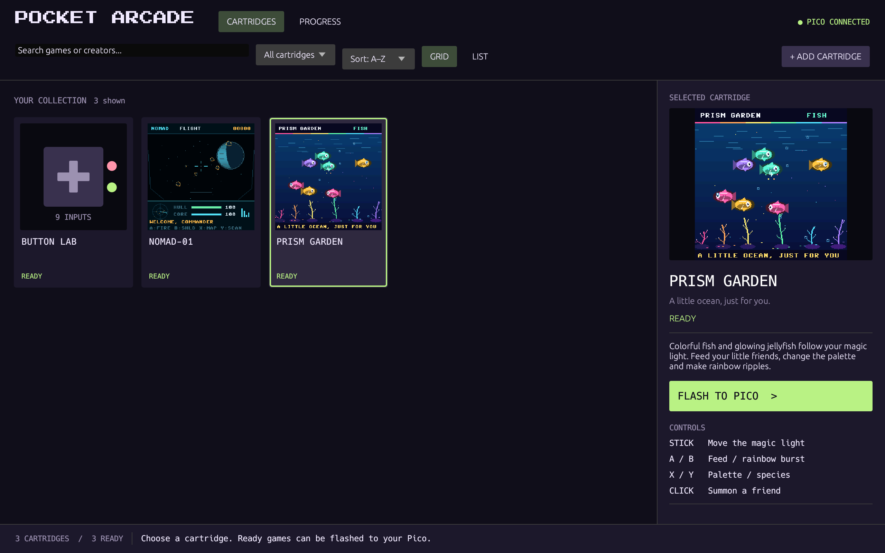
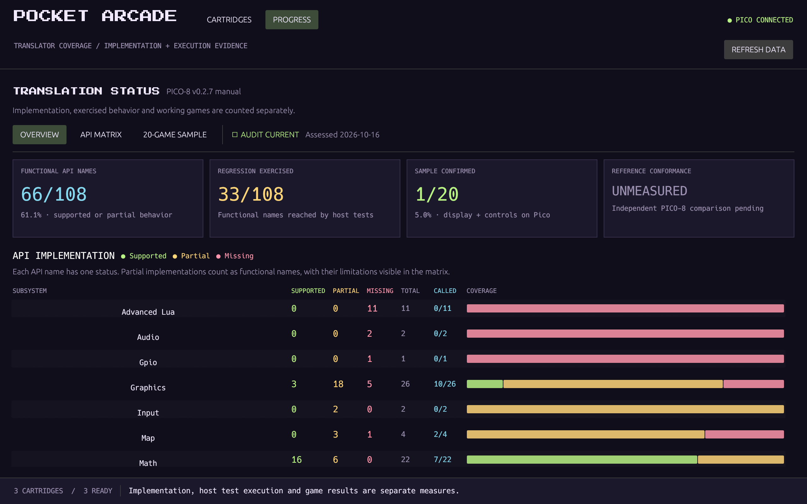
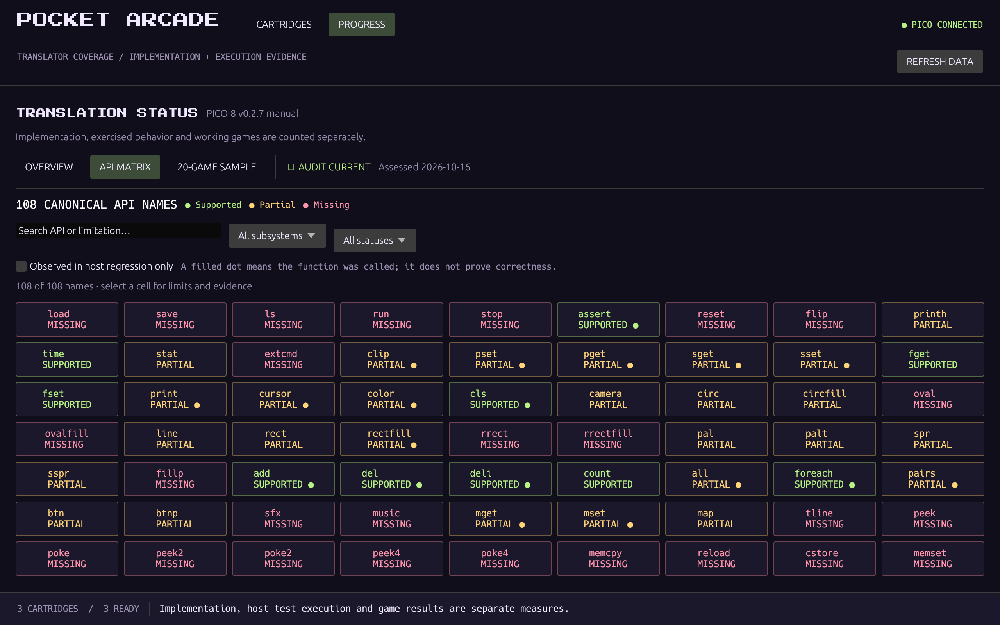
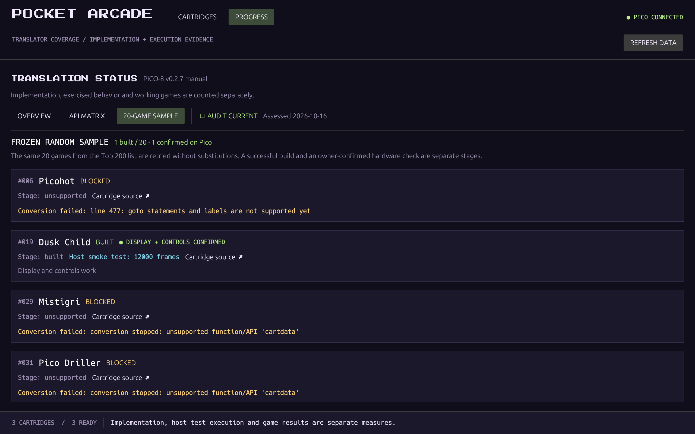
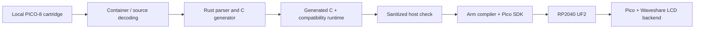

# Pocket AOT

**PICO-8 source cartridges → native firmware for a Raspberry Pi Pico.**

[](https://github.com/devarshi16/pocket-aot/actions/workflows/ci.yml)
[](LICENSE)
[](docs/HARDWARE.md)
[](#status)

Pocket AOT translates a supported subset of PICO-8's Lua dialect into C, links a bounded compatibility runtime, and builds a standalone RP2040 UF2. **Pocket Arcade** is its retro desktop launcher: import a local cartridge, convert it, inspect the result, and flash it from a thumbnail shelf.

Conversion happens on the computer. The flashed program runs on the microcontroller without a Lua interpreter or a computer running the game. This is an experimental ahead-of-time compiler and compatibility layer; it does not run every PICO-8 game.

[Status](#status) · [GUI](#pocket-arcade-gui) · [Build and run](#build-and-run) · [Hardware](docs/HARDWARE.md) · [Architecture](docs/ARCHITECTURE.md) · [Contributing](CONTRIBUTING.md)



*The original-only collection after building NOMAD, Prism Garden and Button Lab locally. A clean checkout includes their sources; firmware is generated on your computer.*

## Status

Assessed **16 October 2026** against a frozen inventory based on the PICO-8 v0.2.7 manual. Implementation, executed test paths, and game results measure different things.


| Measurement | Recorded result | Meaning |
| --- | --- | --- |
| API implementation | **33 supported · 38 partial · 37 missing**, out of 108 | 71 names have some functional behavior (**65.7%**); partial support has documented limitations |
| Public fixture regression | **42/108** functional API names reached in 13 sanitizer scenarios | Reproducible using only the original fixtures included here |
| Full development regression | **48/108** functional API names reached in 8 sanitizer scenarios | Historical execution evidence; external game fixtures are deliberately unbundled |
| Fixed random game sample | **1/20** built; **1/20** display/control confirmed on a Pico | The same 20 sampled games, without substitutions; not a universal compatibility rate |
| Independent reference conformance | **Unmeasured** | No separate PICO-8 oracle or systematic golden-frame suite yet |
| Weighted planning index | **51.4%** across 173 core gates | Secondary engineering estimate with explicit weights and half-credit for partial support |

The [small-gap assessment](docs/SMALL-GAPS.md) records the latest implemented helpers/overloads and ranks the next inexpensive improvements.

The [detailed status](docs/STATUS.md) also records the smaller, reproducible public-fixture regression. A called API is not proof that its outputs match PICO-8. Silent `sfx`/`music` stubs earn no functional credit. A successful build does not guarantee complete gameplay or sufficient performance.

The largest gaps are memory mapping (`peek`/`poke` and related APIs), persistent saves, menu callbacks, coroutines, `goto`/varargs, audio, remaining graphics overloads, and independent reference tests. Unsupported syntax and APIs stop conversion. Resource exhaustion and unsupported runtime argument cases produce explicit errors.

[Full checklist and methodology](converter/PROGRESS.md) · [Machine-readable audits](compatibility/coverage/) · [Historical 20-game results](compatibility/top200/results.json)

The count-first presentation is inspired by [AnyPS5's Status section](https://github.com/boykopovar/AnyPS5#status). This project has one assessed snapshot; it does not yet claim a measured progress history.

## Pocket Arcade GUI

- **Cartridge shelf:** grid or list, search, filters, artwork previews, and per-cartridge conversion failures.
- **Import:** local `.p8` or `.p8.png`, including drag and drop. The build runs a sanitized host smoke test before adding firmware to the shelf.
- **Flash:** select a prepared cartridge and press **FLASH TO PICO**. UF2 checks, device detection and startup checks are included.
- **Progress:** subsystem bars, a searchable API matrix, known limitations and evidence, plus the fixed game sample's stages and blockers.



<details>
<summary>API matrix and per-game results</summary>





</details>

*The public dashboard uses the original-fixture execution profile. The 20-game tab retains historical outcomes and source links; the games themselves are unbundled.*

## Build and run

The desktop workflow currently targets **Linux/X11**. Rust, a C compiler, Python 3, CMake and Ninja are needed for development. Firmware builds additionally need the Raspberry Pi Pico SDK and an Arm embedded compiler.

On Ubuntu/Debian, install the native development packages, then use your normal Rust installation:

```sh
sudo apt-get install build-essential pkg-config libx11-dev libxi-dev \
  libxrandr-dev libxcursor-dev libxinerama-dev libgl1-mesa-dev \
  libudev-dev libxkbcommon-dev cmake ninja-build python3-venv gcc-arm-none-eabi

git clone https://github.com/devarshi16/pocket-aot.git
cd pocket-aot
python3 -m venv .venv
. .venv/bin/activate
pip install -r requirements.txt
cargo build --release --locked --bins
./launch.sh
```

For conversion to UF2, obtain the [Pico SDK](https://github.com/raspberrypi/pico-sdk) with its required submodules, and set:

```sh
export PICO_SDK_PATH=/absolute/path/to/pico-sdk
# Optional when arm-none-eabi-gcc is already on PATH:
export PICO_TOOLCHAIN_PATH=/absolute/path/to/arm-toolchain
```

The development hardware was built with Pico SDK **2.1.1** and Arm GNU **14.3.rel1**. Other toolchain versions require validation.

```sh
# Translate source to generated C without needing the Pico SDK:
./target/release/pocket-aot path/to/your-game.p8 /tmp/generated "Your Game"

# Translate, host-check, build UF2, and add it to the GUI collection:
python3 converter/build.py path/to/your-game.p8 --library

# Create the original demo firmware and populate its three shelf cards:
python3 build_cartridges.py

# Open the status dashboard:
./launch.sh --view progress
```

Then connect the supported hardware, select a built card and press **FLASH TO PICO**. Flashing replaces the program currently installed on the device. On Linux, [USB permissions](docs/HARDWARE.md#usb-access) may need one-time setup. Conversion and viewing progress do not flash anything.

See the [converter guide](converter/README.md) for detailed usage, supported behavior and limits.

## Included original projects

| Project | Description | Implementation |
| --- | --- | --- |
| **NOMAD-01** | Animated spaceship cockpit, star atlas, scanner and hyperspace | MicroPython |
| **Prism Garden** | Colorful aquarium, fish, jellyfish and rainbow ripples | MicroPython |
| **Button Lab** | Live state, count and hold-time checks for all nine switches | MicroPython |

Their source lives in [`demos/`](demos/). They demonstrate the launcher and hardware, and **are not examples of PICO-8 conversion**. The original synthetic cartridges in [`converter/tests/`](converter/tests/) exercise the translation layer.

No external game source, cartridge PNGs, ROMs, generated game C, game firmware, private device backups or cached development toolchains are included. PICO-8 cartridge PNGs encode game data, so they are treated as cartridges rather than screenshots. Import your own local cartridges. Screenshot credits and dependency notices are in [NOTICE.md](NOTICE.md).

## How generic is it?

The **frontend, C generator and game runtime are reusable**. They do not contain a separate handwritten port for each game. The current **device backend is specific to an RP2040 Pico with a Waveshare Pico-LCD-1.3**: ST7789, 240 × 240 color LCD, SPI, and that board's buttons. It scales PICO-8's 128 × 128 framebuffer to the panel.

Another display or button layout needs a backend adaptation in [`converter/runtime/pico.c`](converter/runtime/pico.c). Another microcontroller also needs build, memory, stack and UF2 changes. Pico 2 / RP2350, other panels, Windows and macOS are not currently validated targets. The W radio is not used.



## Development

```sh
cargo fmt --check
cargo test --locked
python3 converter/test_pipeline.py
python3 converter/test_png.py
python3 converter/coverage_report.py --check
python3 scripts/check_publication.py
```

The public tests use original fixtures. Historical game measurements are retained as records, with their source hashes, and do not silently become fresh test results on a clean checkout. GUI changes do not improve the translation score. Scope or scoring changes require a new rubric version.

Useful contributions include behavioral fixtures, reference comparisons, runtime/API work, memory and performance measurements, and additional hardware backends. See [CONTRIBUTING.md](CONTRIBUTING.md).

## License and acknowledgements

Project code is distributed under **GPL-3.0-only**, with third-party components under their retained licenses. The Waveshare-derived display driver is identified and attributed; Shrinko8's MIT-licensed tools handle cartridge container decoding. Press Start 2P is under the SIL Open Font License. Raspberry Pi's SDK and MicroPython are obtained separately when building firmware.

PICO-8 is by [Lexaloffle](https://www.lexaloffle.com/pico-8.php). This is an independent experimental project. See [LICENSE](LICENSE) and [NOTICE.md](NOTICE.md).
