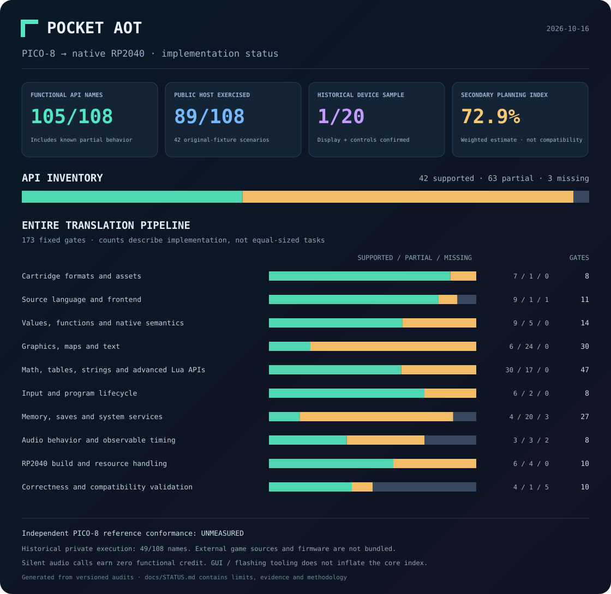

# Status

Snapshot: **2026-10-16** · rubric `pocket-aot-capabilities-v1`.



Inspired by the subsystem reporting style of [AnyPS5](https://boykopovar.github.io/AnyPS5/progress.html). These numbers measure separate things; none is a universal game-compatibility percentage.

| Measure | Result | Meaning |
| --- | ---: | --- |
| Functional API names | 66/108 (61.1%) | Some implemented behavior, including partial support |
| API inventory | 26 supported · 40 partial · 42 missing | Fixed set of canonical names; aliases counted once |
| Current public host execution | 33/108 | Entry points reached in 5 completed original-fixture sanitizer scenarios |
| Historical private host execution | 48/108 | Earlier 8-scenario run, including external cartridges that are not bundled |
| Historical random game sample | 1/20 built; 1/20 owner-confirmed | Earlier RP2040/Waveshare display and controls check; not a new public-suite result |
| Independent PICO-8 reference conformance | **Unmeasured** | No independent oracle, framebuffer or audio differential suite |
| Secondary weighted planning index | 49.8% | Judgment-based rubric; not remaining time or compatibility |

## API coverage

Supported means implemented within the stated audit gate, with no specific omission identified. Partial means a known limitation. Missing includes silent no-ops. Audio stubs receive no functional credit. Host calls establish that code ran; they do not establish output equivalence or cover every argument and overload.

| Subsystem | Supported | Partial | Missing | Total | Public host exercised |
| --- | ---: | ---: | ---: | ---: | ---: |
| system | 2 | 2 | 8 | 12 | 1 |
| graphics | 3 | 18 | 5 | 26 | 10 |
| tables | 5 | 2 | 0 | 7 | 6 |
| input | 0 | 2 | 0 | 2 | 0 |
| audio | 0 | 0 | 2 | 2 | 0 |
| map | 0 | 3 | 1 | 4 | 2 |
| memory | 0 | 0 | 10 | 10 | 0 |
| math | 16 | 6 | 0 | 22 | 7 |
| menu | 0 | 0 | 1 | 1 | 0 |
| strings | 0 | 7 | 0 | 7 | 7 |
| persistence | 0 | 0 | 3 | 3 | 0 |
| gpio | 0 | 0 | 1 | 1 | 0 |
| advanced_lua | 0 | 0 | 11 | 11 | 0 |

## Whole translation pipeline

The frozen scope has **173 acceptance gates** across ten components. The GUI, browsing and flashing checklist is separate and contributes zero to the translation index.

| Component | Supported | Partial | Missing | Gates | Weight | Component score |
| --- | ---: | ---: | ---: | ---: | ---: | ---: |
| Cartridge formats and assets | 6 | 1 | 1 | 8 | 6% | 81.2% |
| Source language and frontend | 7 | 1 | 3 | 11 | 12% | 68.2% |
| Values, functions and native semantics | 5 | 6 | 3 | 14 | 18% | 57.1% |
| Graphics, maps and text | 3 | 21 | 6 | 30 | 18% | 45.0% |
| Math, tables, strings and advanced Lua APIs | 21 | 15 | 11 | 47 | 8% | 60.6% |
| Input and program lifecycle | 2 | 3 | 3 | 8 | 8% | 43.8% |
| Memory, saves and system services | 2 | 2 | 23 | 27 | 8% | 11.1% |
| Audio behavior and observable timing | 0 | 0 | 8 | 8 | 8% | 0.0% |
| RP2040 build and resource handling | 6 | 4 | 0 | 10 | 8% | 80.0% |
| Correctness and compatibility validation | 4 | 1 | 5 | 10 | 6% | 45.0% |

Component score = 100 × (supported + 0.5 × partial) / gates. The overall index is the weighted sum of component scores. Weights and the half-credit rule are fixed judgment calls. Changing partial credit from 0.25 to 0.75 changes the same snapshot from 41.8% to 57.8%; that is scoring sensitivity, not a confidence interval.

## Evidence and reproducibility

The current committed public profile is `public-original-fixtures`. Its source hashes are **fresh**. The runner profiles only scenarios whose success or expected controlled failure was checked. Two additional original fixtures check explicit rejection of unsupported APIs. A separate PNG test roundtrips the original semantic fixture and executes the generated C for 600 sanitized frames.

```sh
cargo test --locked
cargo build --release --locked --bin pocket-aot
python3 converter/test_pipeline.py
python3 converter/test_png.py
python3 converter/coverage_report.py --check
```

The public suite needs no external cartridges, network downloads, Pico SDK or connected board. The optional `test_png.py --arm-build` adds a UF2 build when the SDK and Arm compiler are installed. Supply additional local source explicitly with `test_pipeline.py --external-cart /path/to/game.p8`; this produces a separately labeled profile and never downloads or flashes it.

The earlier private profile is kept byte-for-byte as a dated provenance record. Its external source and firmware are excluded, so it is not presented as reproducible current public execution coverage. Historical game metadata records authors, links, source hashes and first blockers without redistributing cartridges. The 1/20 result does not mean every scene, performance target or behavior was verified.

- [Current public execution profile](../compatibility/coverage/runtime-api-coverage.json)
- [Historical private execution profile](../compatibility/coverage/historical-runtime-api-coverage.json)
- [API limits and evidence](../compatibility/coverage/api-audit.json)
- [Full 173-gate checklist](../compatibility/coverage/CHECKLIST.md)
- [Frozen rubric](../compatibility/coverage/capability-manifest.json)
- [Historical 20-game metadata](../compatibility/top200/results.json)
- [Detailed planning report](../converter/PROGRESS.md)

Open **PROGRESS** in Pocket Arcade for the searchable API matrix and game-result explorer. Refreshing that view reloads evidence; it does not run tests or flash firmware. Re-audit affected gates after implementation changes, refresh source hashes, rerun the public suite and use `python3 converter/coverage_report.py --write` to regenerate this page and graph. Adding scope or changing weights requires a new rubric version.
